<h1 align="center">Pagination by AMA</h1>

<p align="center">
  A 100% native Android app showing random users from <a href="https://randomuser.me">randomuser.me</a>, with infinite scroll and offline cache.<br/>
  Built with Jetpack Compose and Material 3, for phones, tablets and foldables.
</p>

<p align="center">
  
  
  
  
  
  <br/>
  
  
  
  
  
</p>

<p align="center">
  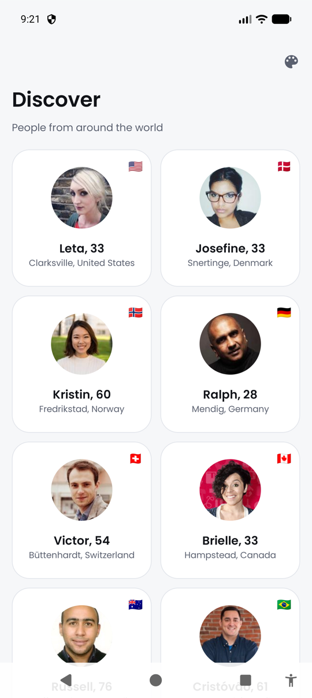
  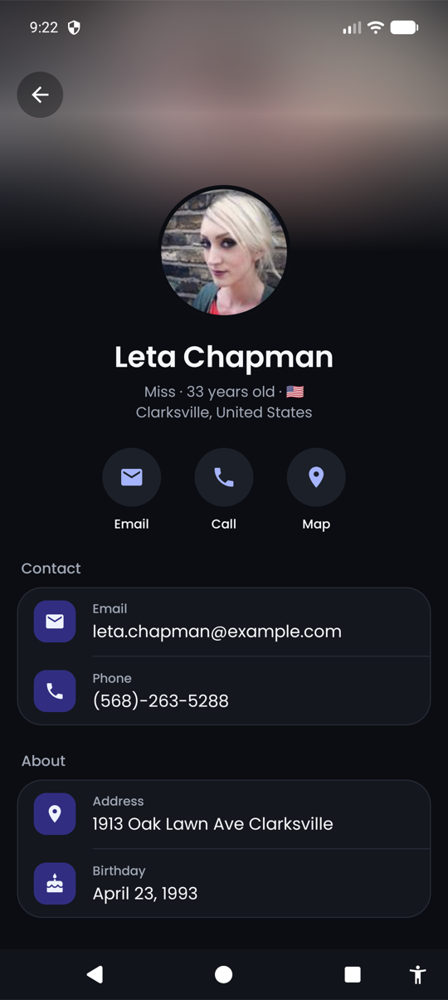
  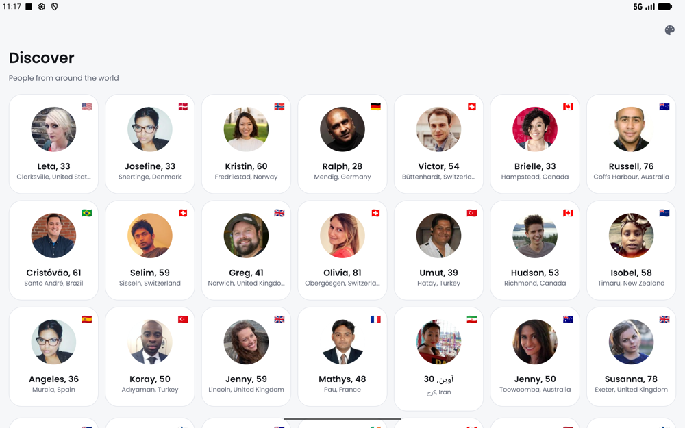
</p>

It mirrors [PaginationDemoMultiPlatform](https://github.com/AntoineMarchaud/PaginationDemoMultiPlatform), the Kotlin Multiplatform version: same architecture, same tests, same look.

## Screenshots

| List | Detail | List (dark) | Detail (dark) |
|:---:|:---:|:---:|:---:|
|  | 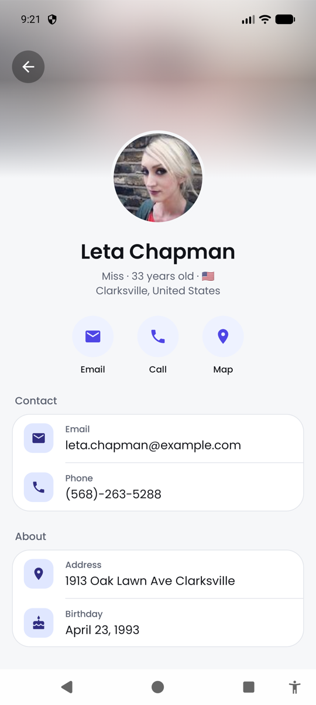 | 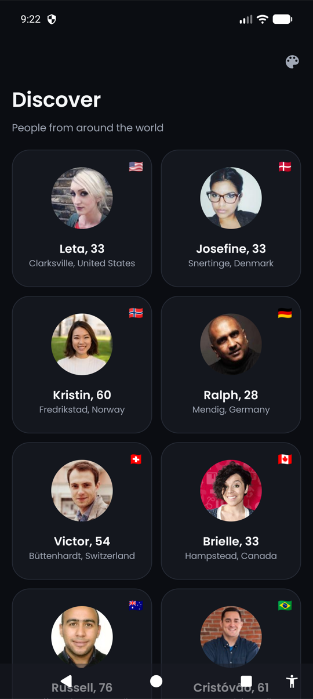 |  |

| "Material You" option | Dynamic colors |
|:---:|:---:|
| 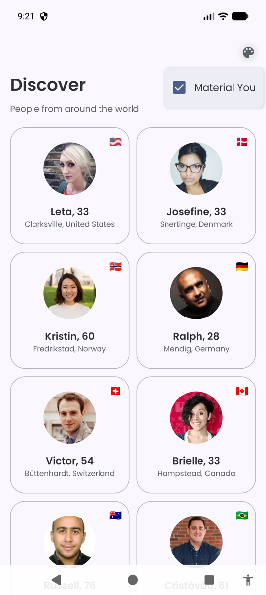 | 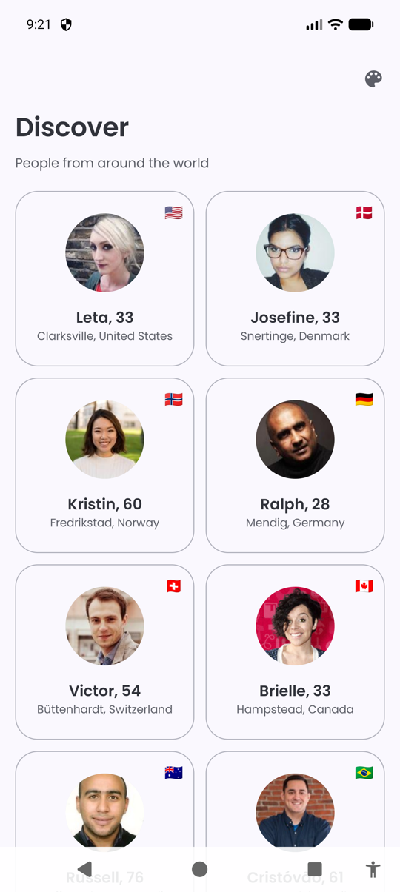 |

**Tablet and foldable**

| Tablet (landscape) | Tablet detail |
|:---:|:---:|
|  | 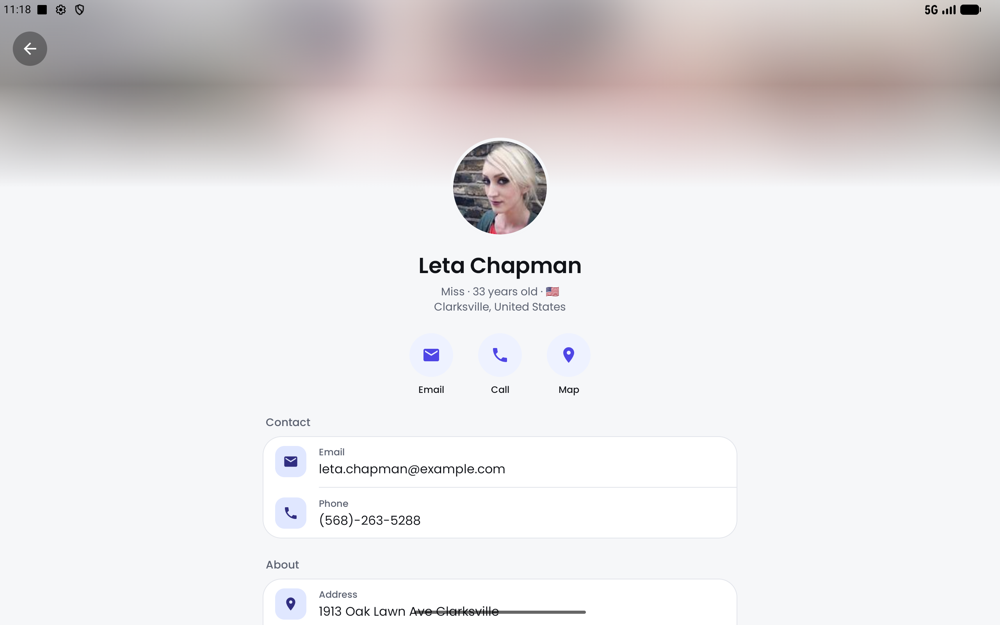 |

| Foldable closed | Foldable open | Foldable open, detail |
|:---:|:---:|:---:|
| 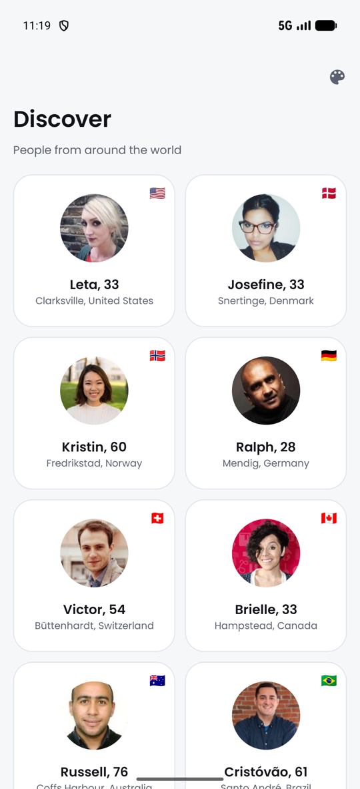 | 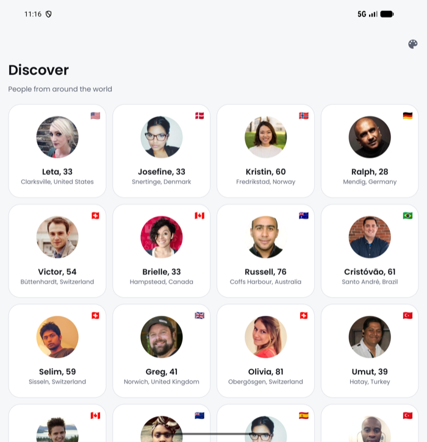 | 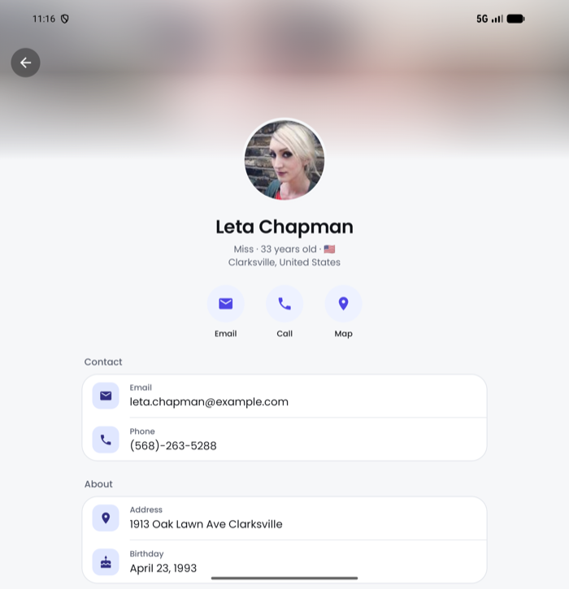 |

## Tech Stack

- Kotlin 2.4, KSP, Gradle 9.9 / AGP 9.5, version catalog (TOML)
- Jetpack Compose (BOM 2026.09), Material 3, Navigation 3
- Hilt (with assisted injection for the detail screen)
- Room + Paging 3 (`RemoteMediator`: network + local cache)
- Retrofit 3 + OkHttp 5 + Kotlinx Serialization
- Coil 3
- MVI + Clean Architecture
- Unit tests: JUnit 4, kotlinx-coroutines-test, paging-testing

## Project Structure

```
PaginationDemo/
├── app/      # Application: MainActivity, navigation (Navigation 3), Hilt entry point, app icon
├── ui/       # MVI ViewModels, contracts, Compose screens, theme and previews
├── domain/   # Use cases, repository interfaces, models (pure Kotlin)
└── data/     # Repositories, Retrofit API, Room database, RemoteMediator, settings
```

## Architecture (MVI)

Each screen has a contract:

- **State**: an immutable data class exposed as a `StateFlow`;
- **Action**: everything the user does, sent with `viewModel.onAction(...)`;
- **Event**: one-shot effects (navigation, refresh, opening a link), sent through a `Channel` and collected with `ObserveAsEvents`.

Navigation decisions are taken by the ViewModels, so they are unit tested.

## Features

- Infinite scroll with a local Room cache (works offline)
- Pull-to-refresh (the large "Discover" title expands first)
- Avatar shared-element transition from the list to the detail screen
- Detail screen: blurred parallax header, Email / Call / Map quick actions (maps open the user's city: randomuser.me streets, regions and coordinates are random)
- Light and dark themes, **"Material You" option** (system dynamic colors, Android 12+, remembered between launches)
- Phones, tablets and foldables: adaptive grid, detail content centered on large screens, no state lost on rotation or fold
- Skeleton loading, full-screen and inline error states with readable messages (no internet, timeout, server error…)
- Zero compiler warnings

## Tests

```bash
./gradlew test
```

Unit tests cover the use cases, the data layer (API error mapping, `RemoteMediator`, repository, mappers, serializers, Room converter, settings) and the ViewModels (state, navigation events, contact links, refresh, "Material You").

## What's missing

- Code quality: KtLint, Detekt
- UI tests
